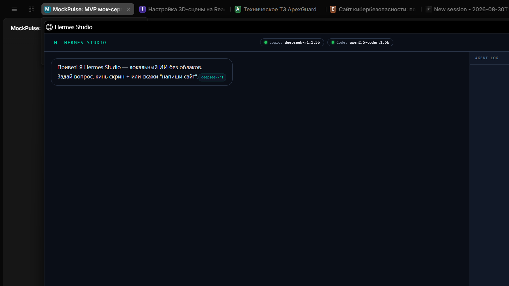

<div align="center">

# ◆ Hermes Studio

### Hermes Studio — Agentic Tool Suite with Vision

**No cloud. No API keys. No subscription. Just your machine.**

[](https://python.org)
[](https://ollama.com)
[](LICENSE)
[]()

<br/>



</div>

---

## What is this?

Hermes Studio v3 is an **autonomous AI agent** that builds complete software projects on your disk. External or local AI is the "brain", Hermes is its "hands".

| Model | Purpose | Size |
|-------|---------|------|
| **deepseek-r1:1.5b** | Reasoning, analysis, conversation | ~1.1 GB |
| **qwen2.5-coder:1.5b** | Code generation, HTML/CSS/JS, agent loop | ~986 MB |
| **llava:1.6-mistral** | Vision — analyze screenshots, images, UI | ~4.1 GB |

**Two modes:**
- **Chat** — ask anything, get answers (like a normal AI assistant)
- **Agent** — describe a project, Hermes builds it step by step with tools

---

## Features

### Agent Toolkit (8 Tools)
| Tool | Description |
|------|-------------|
| `workspace_file_ops` | Read, write, create, delete, list, grep, search_replace, read_lines |
| `execute_shell_command` | Run `npm install`, `pytest`, `tsc`, etc. with timeout |
| `git_checkpoint` | Auto-commit after each successful step |
| `analyze_project_structure` | Scan directory tree to understand architecture |
| `capture_screenshot` | Take screenshots of screen/window for visual analysis |
| `read_image` | Read images from disk for vision model analysis |
| `search_code` | Regex search across codebase with context lines |
| `done` | Signal task completion with summary |

### Core
- **Agent Loop** — iterative tool calling with OpenAI/Ollama compatible JSON Schema
- **Live Execution Stream** — real-time panel showing which tool is running
- **Smart Router** — automatic prompt classification (reasoning vs coding vs vision)
- **Vision Support** — analyze screenshots, images, UI elements with llava model
- **Screenshot Capture** — take screenshots directly from the agent
- **Code Search** — regex search across codebase with context
- **Streaming responses** — text appears token by token
- **File upload** — attach images for vision analysis
- **100% offline** — works without internet, no data leaves your PC
- **D: drive storage** — models, workspace, backups on D:
- **One-click launch** — double-click `Hermes.bat` and done
- **Glassmorphism UI** — dark theme, Linear/Vercel style

---

## Quick Start

### 1. Install

```bash
git clone https://github.com/cokovali10-sketch/hermes-studio.git
cd hermes-studio
pip install -r requirements.txt
```

### 2. Download models

```bash
ollama pull deepseek-r1:1.5b
ollama pull qwen2.5-coder:1.5b
```

### 3. Launch

```bash
# Option A: double-click
Hermes.bat

# Option B: terminal
python launch.py
```

Browser opens automatically → **http://127.0.0.1:8765**

---

## Architecture

```
┌─────────────────────────────────────────────────┐
│                    Browser                       │
│              (Edge / Chrome app)                 │
│  ┌──────────┐  ┌────────────────────────────┐   │
│  │  Chat UI  │  │  Live Execution Stream      │   │
│  └──────────┘  └────────────────────────────┘   │
└──────────────────────┬──────────────────────────┘
                       │ HTTP
┌──────────────────────▼──────────────────────────┐
│               server.py (:8765)                  │
│  ┌─────────────┐  ┌─────────────────────────┐   │
│  │ Smart Router │  │     Event Bus (SSE)     │   │
│  └──────┬──────┘  └─────────────────────────┘   │
│  ┌──────▼──────┐  ┌─────────────────────────┐   │
│  │ Agent Loop   │  │   Tool Dispatcher       │   │
│  │ (iterative)  │  │   ├─ file_ops           │   │
│  └──────┬──────┘  │   ├─ shell_command      │   │
│         │         │   ├─ git_checkpoint      │   │
│         │         │   ├─ project_analysis    │   │
│         │         │   └─ done                │   │
└─────────┼─────────┴─────────────────────────┘
          │ HTTP
┌─────────▼───────────────────────────────────────┐
│             Ollama (:11434)                     │
│  ┌──────────────┐  ┌─────────────────────────┐  │
│  │ deepseek-r1  │  │   qwen2.5-coder          │  │
│  │  (reasoning) │  │   (coding + agent)        │  │
│  └──────────────┘  └─────────────────────────┘  │
└─────────────────────────────────────────────────┘
```

**How Agent Loop works:**

```
User: "Create a React todo app with TypeScript"
  ↓
Agent calls: workspace_file_ops(action="write", path="package.json", content=...)
Agent calls: workspace_file_ops(action="write", path="src/App.tsx", content=...)
Agent calls: execute_shell_command(command="npm install")
Agent calls: execute_shell_command(command="npm run build")
Agent calls: git_checkpoint(message="feat: initial todo app")
Agent calls: done(summary="React todo app created with TypeScript, Tailwind CSS")
```

---

## Project Structure

```
hermes-studio/
├── launch.py          # Single-instance launcher
├── server.py          # Backend + Agent Loop + Tool Dispatcher
├── setup_models.py    # Model downloader
├── config.json        # Configuration
├── requirements.txt   # Python dependencies
├── Hermes.bat         # One-click launcher
├── frontend/
│   └── index.html     # Glassmorphism UI + Agent Stream
├── workspace/         # Agent builds projects here
├── backups/           # Auto-backups before file overwrites
└── screenshots/
    └── main.png       # App screenshot
```

---

## Tech Stack

| Layer | Technology |
|-------|-----------|
| Frontend | HTML5 + CSS3 + Vanilla JS (Glassmorphism) |
| Backend | Python 3.10+ / aiohttp |
| AI Engine | Ollama (local inference) |
| Models | DeepSeek-R1 1.5B, Qwen2.5-Coder 1.5B |
| Agent | OpenAI/Ollama compatible Function Calling |
| Streaming | Server-Sent Events (SSE) |
| Storage | D: drive (models + workspace + backups) |

---

## System Requirements

- **OS:** Windows 10/11
- **RAM:** 8 GB minimum (16 GB recommended)
- **Disk:** 3 GB free (2 GB models + 1 GB app)
- **GPU:** Optional (CPU inference works fine for 1.5B models)

---

## API Endpoints

| Method | Path | Description |
|--------|------|-------------|
| `GET` | `/` | Frontend UI |
| `GET` | `/api/health` | Health check + version |
| `GET` | `/api/models` | Installed models status |
| `GET` | `/api/tools` | Tool schemas (JSON Schema) |
| `GET` | `/api/workspace` | Workspace file tree |
| `POST` | `/api/chat` | Chat (`?stream=1` for SSE) |
| `POST` | `/api/agent` | Agent loop with tool calling (SSE) |
| `POST` | `/api/analyze_image` | Vision analysis of uploaded image |
| `POST` | `/api/upload` | File upload |
| `GET` | `/api/events` | SSE event stream |

---

## Tool Schema (OpenAI Compatible)

```json
{
  "type": "function",
  "function": {
    "name": "workspace_file_ops",
    "description": "Read, write, create, delete, or list files",
    "parameters": {
      "type": "object",
      "properties": {
        "action": {"type": "string", "enum": ["read", "write", "create", "delete", "list", "list_tree"]},
        "path": {"type": "string"},
        "content": {"type": "string"}
      },
      "required": ["action", "path"]
    }
  }
}
```

---

## Configuration

Edit `config.json`:

```json
{
  "models": {
    "reasoning": "deepseek-r1:1.5b",
    "coding": "qwen2.5-coder:1.5b",
    "agent": "qwen2.5-coder:1.5b"
  },
  "server": { "port": 8765 },
  "paths": {
    "workspace": "D:/PortfolioProjects/Hermes/workspace",
    "backups": "D:/PortfolioProjects/Hermes/backups"
  },
  "tools": {
    "git_auto_commit": true,
    "backup_on_write": true
  }
}
```

---

## License

MIT — use it however you want.

---

<div align="center">

**Built with care. Runs on your machine. Your data stays yours.**

</div>
